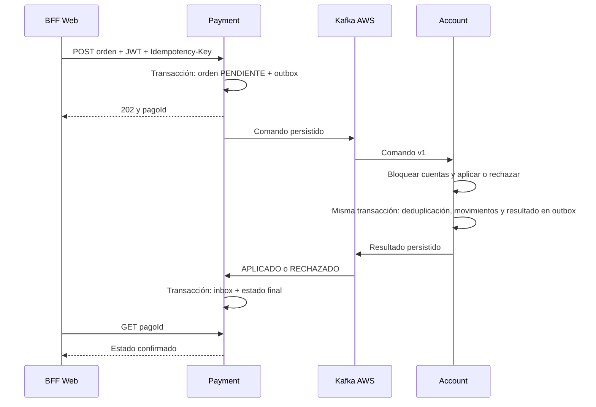

# Pagos EFT: órdenes, movimientos y confirmación

Estado al 7 de octubre de 2026: implementado y probado por HTTPS con Kafka AWS y
MySQL local. El depósito, la transferencia y el pago terminaron APLICADO; el caso
sin fondos terminó RECHAZADO. Los saldos finales de demostración fueron 60/40.
Se comprobó además la recuperación de una orden que había quedado pendiente.
Dos reentregas del mismo comando por Kafka mantuvieron saldo y versión originales;
el consumidor terminó sin mensajes pendientes (lag 0).

| Configuración AWS usada | Valor |
|---|---|
| Instancia Kafka existente | i-05c6942a4f6dd7734, us-east-1 |
| IP elástica / endpoint | 100.29.239.217:9093 |
| Broker | apache/kafka:4.1.2, KRaft |
| Transporte | SASL_SSL / PLAIN, certificado verificado |
| Nuevo usuario | payment; contraseña en secrets, no en Git |
| Grupos nuevos | account-payments y payment-service |
| Acceso administrativo utilizado | SSH 22; publicación Kafka 9093 |
| MySQL y microservicios | Locales; sin RDS ni nuevas EC2 |

## Alcance

Se añade payment-service; account-service mantiene la propiedad exclusiva de
los saldos. Se trabaja sobre cuentas modernas UUID. No se reinterpretan los CSV
como transferencias ni se modifican cuentas o saldos históricos migrados.
El operador técnico web-demo está autorizado a realizar las operaciones de
demostración. No es un login de titulares ni una integración con dinero externo.
Los depósitos de prueba son fondos sintéticos.

Operaciones soportadas:

| Tipo | Origen | Destino | Comportamiento |
|---|---|---|---|
| DEPOSITO | Ausente | Cuenta activa | Abona el monto |
| TRANSFERENCIA | Cuenta activa con fondos | Otra cuenta activa | Débito y crédito atómicos |
| PAGO | Cuenta activa con fondos | Cuenta beneficiaria activa | Mismo movimiento atómico, con referencia del pago |

PAGO representa un pago a un beneficiario con cuenta dentro del sistema; no cobra
tarjetas ni paga facturas de un proveedor externo. Moneda CLP. Monto positivo,
máximo 15 dígitos enteros y 2 decimales. No hay sobregiro. Las cuentas bloqueadas,
cerradas o inexistentes producen un rechazo. No se admite origen igual a destino.

## Flujo y garantías



202 confirma el registro durable de la orden; no confirma un movimiento de dinero.
Mientras está PENDIENTE no debe repetirse con otra clave. Reintentar con la misma
clave y contenido devuelve la misma orden. Cambiar el contenido devuelve 409.
Los GET de Pagos filtran por el sujeto del JWT.

Cada publicador bloquea una fila pendiente con FOR UPDATE SKIP LOCKED y solo
marca published_at después del ACK de Kafka. Si se pierde el proceso entre ACK
y COMMIT, el mensaje puede repetirse: la deduplicación de Account y el inbox de
Payment evitan repetir efectos. Es entrega al menos una vez con efectos
idempotentes, no una transacción distribuida exactamente una vez.

Account bloquea las cuentas siempre en orden de UUID; débito, crédito, auditoría,
registro de operación y resultado se confirman juntos. Dos retiros de fondos
concurrentes no pueden sobregirar. El cierre usa los mismos bloqueos de cuentas;
una operación aplicada incrementa la versión y evita cierres con una versión vieja.

Las reglas de negocio generan RECHAZADO y un motivo (por ejemplo SALDO_INSUFICIENTE).
Contratos inválidos y fallos agotados van a DLT tras la política de reintentos.
Un caso en DLT puede dejar la orden PENDIENTE: revisar causa y recuperar el mismo
mensaje/ID, sin crear una orden nueva ni reiniciar offsets indiscriminadamente.
Los resultados incluyen el hash del comando para rechazar confirmaciones ajenas.
Los contratos PaymentCommand/PaymentResult se mantienen idénticos en ambos módulos.

## Datos añadidos

| Servicio/esquema | Tablas | Finalidad |
|---|---|---|
| Payment / bancoxyz_payments | payments, payment_outbox, payment_inbox | Órdenes, envío durable y confirmaciones |
| Account / lab_batch | account_payment_operations, account_payment_ledger, account_payment_outbox | Deduplicación, movimientos y resultados durables |
| Account / lab_batch | modern_accounts, modern_account_audit | Saldo/versiones y auditoría ya existentes |

Payment usa Flyway. Account crea sus tres tablas adicionales de manera aditiva;
no borra ni migra automáticamente las tablas legacy. Sus cambios futuros requieren
migraciones explícitas. No ejecutar el batch para arrancar Pagos.

## Contrato público y ejemplo

| Método/ruta | Scope |
|---|---|
| POST /api/web/pagos | web.payments.write |
| GET /api/web/pagos/{uuid} | web.payments.read |
| GET /api/web/pagos?page=0&size=20 | web.payments.read |

POST requiere Idempotency-Key UUID y JSON:

```json
{"tipo":"TRANSFERENCIA","origen":"UUID cuenta origen","destino":"UUID cuenta destino","monto":30.00,"referencia":"Transferencia demo"}
```

Para depósito omitir origen. Para PAGO cambiar tipo y especificar referencia.
Errores inmediatos: 400 contrato inválido, 401 sin token, 403 sin permiso, 409 clave
en conflicto, 503 Payment no disponible. Los rechazos de saldo/estado de cuenta
se consultan como estado RECHAZADO, no como respuesta HTTP del POST.

## Arranque local sin transporte de Pagos

Desde proyecto8, PowerShell 7, con MySQL y Docker iniciados:

```powershell
./scripts/Initialize-PaymentDatabase.ps1
foreach ($module in @('payment-service','account-service','auth-server','bff-web')) {
    Push-Location $module
    ./mvnw.cmd package
    if ($LASTEXITCODE -ne 0) { Pop-Location; throw "Fallo en $module" }
    Pop-Location
}
docker compose up -d --build payment-service account-service auth-server bff-web https-proxy
docker compose restart https-proxy
./scripts/Test-PaymentFlow.ps1 -QueueOnly
```

QueueOnly crea un titular, dos cuentas sintéticas y un depósito pendiente de 100.
Prueba 401/403, 202, duplicación, conflicto 409, monto inválido 400, persistencia y
saldo aún cero. La orden permanece guardada y se procesará al activar el transporte.
No es una demostración del procesamiento completo. Cada ejecución añade datos de
prueba; los conserva y muestra sus UUID sin imprimir tokens.

## Activación de Kafka AWS

Requiere Learner Lab iniciado, EC2 accesible en 100.29.239.217, puertos 22/9093
permitidos desde la IP pública del PC y broker funcionando. El script siguiente
añade el usuario payment, cuatro tópicos y ACL; reinicia brevemente el contenedor
del broker preservando el volumen y los usuarios existentes. Ejecutar desde proyecto8:

```powershell
$key="$env:USERPROFILE/Documents/bancoxyz-kafka.pem"
scp -i $key ./deploy/kafka/create-payments.sh ec2-user@100.29.239.217:~/kafka/create-payments.sh
ssh -i $key ec2-user@100.29.239.217 'cd ~/kafka && bash create-payments.sh'
scp -i $key ec2-user@100.29.239.217:~/kafka/secrets/payment.properties ./secrets/kafka/payment.properties
docker compose -f compose.yaml -f compose.payments-kafka.yaml up -d account-service payment-service
./scripts/Test-PaymentFlow.ps1
./scripts/Test-Stack.ps1 -CuentaId 137
```

Para siguientes arranques con procesamiento activo mantener ambos archivos Compose.
Ejecutar solo el Compose principal recrea estos servicios sin activar el transporte
de Pagos: las nuevas órdenes seguirán guardadas, pero no avanzarán hasta reactivarlo.
No publicar .env ni secrets. La clave de payment se preserva al repetir el script.

| Tópico | Productor | Consumidor/grupo |
|---|---|---|
| bancoxyz.pagos.commands.v1 | payment | account / account-payments |
| bancoxyz.pagos.results.v1 | account | payment / payment-service |
| bancoxyz.pagos.commands.v1.dlt | account | Inspección UI |
| bancoxyz.pagos.results.v1.dlt | payment | Inspección UI |

Una partición, réplica 1, retención de un día/256 MiB por tópico. Es el mismo
broker de laboratorio sin alta disponibilidad. Los outbox guardan mensajes no
confirmados; una interrupción superior a la retención después de publicar puede
requerir recuperación manual. No borrar órdenes/outbox/inbox para resolver fallos.
Kafka UI recibe permisos de lectura sobre estos tópicos y descripción de grupos.

## Validaciones

Test-PaymentFlow.ps1 completo crea cuentas sintéticas, deposita 100, transfiere 30,
paga 10 y rechaza otra transferencia de 1000. Espera el resultado de cada operación
antes de enviar la siguiente. Comprueba saldos finales 60/40 y rechazo de cierre
con saldo. Si una orden no termina en dos minutos, informa el UUID pendiente;
no inventa un resultado ni duplica la operación con otra clave.

Las pruebas Maven verifican concurrencia, transferencias opuestas, rollback de
saldos/ledger/outbox, contrato inválido, rechazo por cuenta inactiva, deduplicación,
resultados contradictorios y publicación tras ACK. KafkaTemplate está simulado en
esas pruebas; la validación AWS requiere ejecutar el flujo completo anterior.

## Canales y retiros

Web permite DEPOSITO, TRANSFERENCIA y PAGO; Móvil TRANSFERENCIA y PAGO;
Cajero DEPOSITO y RETIRO. Payment aplica las restricciones en el dominio.
RETIRO exige origen con fondos y destino ausente. Flyway V2 permite destino
nulo conservando las órdenes existentes. Usa la misma transacción de saldo,
auditoría e idempotencia; simula el débito, sin dispensador físico.
La prueba integrada confirmó retiro aplicado, repetición sin segundo débito
 y rechazo por saldo insuficiente. Ver [canales](CANALES_EFT.md).
